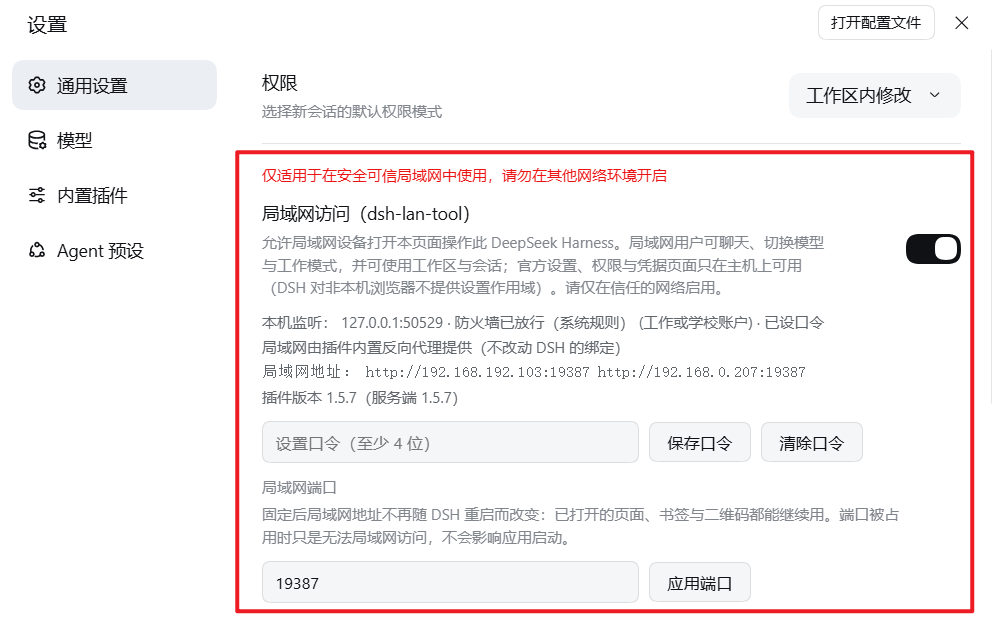

<h1 align="center">dsh-lan-tool</h1>

<p align="center">
  <b>Password-gated LAN access for the <a href="https://github.com/deepseek-ai/deepseek-harness">DeepSeek Harness</a> Web GUI</b><br>
  Full access over the LAN · plugin-owned reverse proxy · no password on the host · phones/tablets use the official UI
</p>

<p align="center">
  <a href="README.md"><kbd>简体中文</kbd></a>
  &nbsp;
  <a href="README.en.md"><kbd><b>English</b></kbd></a>
</p>

<p align="center">
  <a href="https://www.npmjs.com/package/dsh-lan-tool"></a>
  <a href="https://www.npmjs.com/package/dsh-lan-tool"></a>
  <a href="LICENSE"></a>
  <a href="https://github.com/deepseek-ai/deepseek-harness"></a>
  <a href="https://github.com/MrMu666/dsh-lan-tool/releases"></a>
  <a href="https://github.com/MrMu666/dsh-lan-tool/stargazers"></a>
</p>

---

> ⚠️ **Version requirement**: `1.7.1` supports DSH desktop **`0.2.2-rc.1`** only (`engines.dsh` pins it exactly; other versions are refused as `incompatible-version`). For older DSH releases use the matching older plugin — see [Releases](https://github.com/MrMu666/dsh-lan-tool/releases).

Open the same DeepSeek Harness from a phone, tablet, or another computer on your LAN: **a password is required before the page is shown**, while the host machine itself needs none.

<div align="center">



</div>

## Install

1. Open the DSH sidebar **Plugins** page and install the package **`dsh-lan-tool`**;
2. **Fully quit the desktop app and reopen it** (the node half is loaded once per app run);
3. Open Settings → General → "LAN access", **set a password** (at least 4 characters), then turn the switch on.

> A brand-new release may be held back by pnpm's 24-hour window; install the version explicitly, e.g. `dsh-lan-tool@1.7.1`.
>
> Pairs well with [DSH-Launcher](https://github.com/MrMu666/DSH-Launcher) and [dsh-app](https://github.com/MrMu666/dsh-app).

## Usage

- Once enabled, the settings card lists the available LAN URLs; open `http://<host-ip>:<port>` on a LAN device and enter the password.
- DSH picks a port on every start, so the **port may change**. To pin it, enter a "LAN port" (1024–65535) in the card and press "Apply port".
- Phones/tablets use the official narrow layout — no extra setup needed.
- Windows may ask once about firewall access on first enable; click Allow. The card picks the OS rule up automatically.

## What LAN devices can do

| Capability | LAN device |
|---|---|
| Chat, model & work-mode switching, workspaces/sessions, history, tasks, approvals, terminal | ✅ available |
| Settings / permission presets / credentials / preset management | ❌ host-only (change them on the host) |
| Workspace directory picker | ✅ the plugin's own dialog |

## Security

- **The password gate is the entire security boundary**: LAN devices must carry the password, while requests from the host machine are always admitted.
- Anyone with the password can read and write all of this DSH's data — use a strong password and **only enable this on trusted networks**; turn it off on public networks.
- The plugin listens only on this machine's current LAN interface addresses (never a wildcard); turning the switch off stops the listener immediately.

## FAQ

- **No card in Settings after a DSH upgrade / `/dsh-lan/status` answers 404**: an upgrade only updates the dependency, it does not re-add `dsh.profile.bundles`. After installing the new version, re-enable it on the Plugins page, then fully quit and reopen.
- **No card after a reinstall**: the profile patch may still carry the stale rows below — delete them, save, and refresh the page:
  ```yaml
  - id: dsh-lan-tool
    disabled: true
  ```
- **Phone shows `dsh web authentication required…`**: the URL carries a stale `?token=`. Use the clean address from the card; since 1.7.1 it also redirects to the password page automatically.
- **A LAN page keeps saying "reconnecting"**: DSH changed its port. Refresh the page, or pin the LAN port in the card.

## Uninstall

Remove it on the Plugins page. The LAN listener closes immediately; firewall rules and patch leftovers are cleaned up about 8 seconds later. To remove the password as well, delete `%USERPROFILE%\.dsh\dsh-lan.json`.

## License

Released under the [MIT License](LICENSE) (Copyright © 2026 MrMu666).
