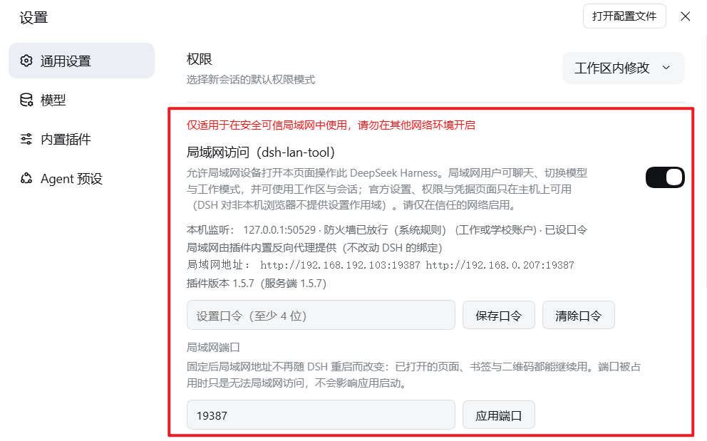

<h1 align="center">dsh-lan-tool</h1>

<p align="center">
  <b><a href="https://github.com/deepseek-ai/deepseek-harness">DeepSeek Harness</a> Web GUI 的局域网访问插件</b><br>
  带口令的全功能版 · 插件内置反向代理 · 主机免口令 · 手机/平板直接用官方界面
</p>

<p align="center">
  <a href="README.md"><kbd><b>简体中文</b></kbd></a>
  &nbsp;
  <a href="README.en.md"><kbd>English</kbd></a>
</p>

<p align="center">
  <a href="https://www.npmjs.com/package/dsh-lan-tool"></a>
  <a href="https://www.npmjs.com/package/dsh-lan-tool"></a>
  <a href="LICENSE"></a>
  <a href="https://github.com/deepseek-ai/deepseek-harness"></a>
  <a href="https://github.com/MrMu666/dsh-lan-tool/releases"></a>
  <a href="https://github.com/MrMu666/dsh-lan-tool/stargazers"></a>
</p>

---

> ⚠️ **版本要求**：`1.7.1` 仅支持 DSH 桌面版 **`0.2.2-rc.1`**（`engines.dsh` 精确锁定，其它版本会被拒绝安装/启用）。旧版 DSH 请使用对应的旧版插件，见 [Releases](https://github.com/MrMu666/dsh-lan-tool/releases)。

让手机、平板或另一台电脑通过局域网打开同一份 DeepSeek Harness：**先输口令才能看页面**，主机自己打开**不需要口令**。

<div align="center">



</div>

## 安装

1. 在 DSH 侧栏 **Plugins** 页输入包名 **`dsh-lan-tool`** 安装；
2. **完全退出桌面版，再重新打开**（node 半边只在启动时载入）；
3. 打开 设置 → General →「局域网访问」，**先设置访问口令**（至少 4 位），再打开开关。

> 刚发布的版本可能被 pnpm 的 24 小时窗口挡回旧版；此时在 Plugins 页显式写版本，例如 `dsh-lan-tool@1.7.1`。
>
> 也可以配合 [DSH-Launcher](https://github.com/MrMu666/DSH-Launcher) 与 [dsh-app](https://github.com/MrMu666/dsh-app) 使用。

## 使用

- 开关打开后，设置卡片会列出可用的局域网地址；局域网设备打开 `http://<本机IP>:<端口>`，输入口令即可。
- 端口由 DSH 每次启动时分配，**可能变化**。想固定：在卡片里填「局域网端口」（1024–65535）并点「应用端口」。
- 手机/平板直接使用官方窄屏界面，无需额外设置。
- Windows 首次开启可能弹一次防火墙询问，点「允许」即可；卡片会自动识别系统规则。

## 局域网设备能做什么

| 能力 | 局域网设备 |
|---|---|
| 聊天、模型与工作模式切换、工作区/会话、历史、任务、审批、终端 | ✅ 可用 |
| 设置 / 权限预设 / 凭据 / 预设管理页面 | ❌ 仅主机可用（请在主机上修改） |
| 工作区目录选择 | ✅ 插件自带的目录选择器 |

## 安全

- **口令门是唯一的安全边界**：局域网设备必须携带口令，主机自己的请求始终放行。
- 持有口令的人可以读写该 DSH 的全部数据，请设置强口令，并**只在可信网络开启**；公共网络请关闭开关。
- 插件只监听本机当前的局域网接口地址（不使用通配地址）；关闭开关会立即停止对外监听。

## 常见问题

- **升级 DSH 后设置页没有卡片 / `/dsh-lan/status` 404**：升级只会更新依赖，不会重新加入 `dsh.profile.bundles`。装好新版后在 Plugins 页重新启用，再完全退出重启。
- **重装后没有卡片**：profile 补丁可能残留下面两行，删掉并保存后刷新页面：
  ```yaml
  - id: dsh-lan-tool
    disabled: true
  ```
- **手机打开显示 `dsh web authentication required…`**：地址里带了过期的 `?token=`。用卡片里的干净地址即可；1.7.1 起也会自动跳转到口令页。
- **局域网页面一直“重新连接中”**：DSH 换了端口。刷新页面，或在卡片里固定局域网端口。

## 卸载

在 Plugins 页移除即可。局域网监听会立即关闭；防火墙规则与补丁残留约 8 秒后清理。若要一并清除口令，删除 `%USERPROFILE%\.dsh\dsh-lan.json`。

## 许可证

[MIT 许可证](LICENSE)（Copyright © 2026 MrMu666）
