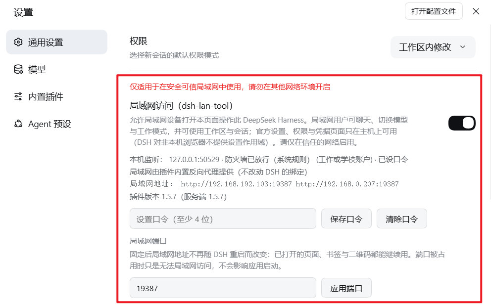
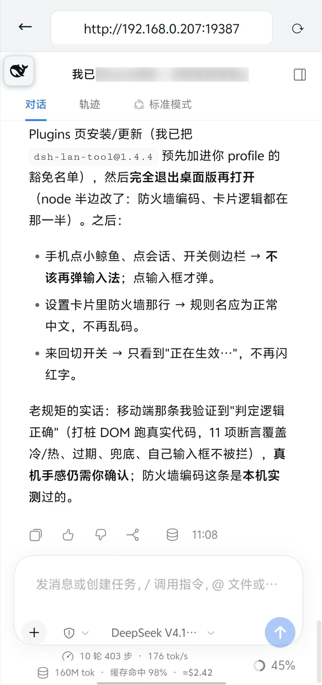

# dsh-lan-tool

[deepseek-harness](https://github.com/deepseek-ai/deepseek-harness) Web GUI 的局域网访问插件（带口令的全功能版；**移动端优化官方界面 UI，适配竖屏及触控手势**）。

> ⚠️ **版本要求：`@deepseek-ai/dsh` `0.2.0-rc.2` 及以上**（桌面版 0.2.0-rc.2 实测通过）。0.1.x 的旧 API（`dsh-host-apiproxy`、点分式端点、`settingsScope` 客户端服务）已不再兼容，请先升级 DSH。

> 🚀 **配合 [DSH-Launcher](https://github.com/MrMu666/DSH-Launcher) 与 [dsh-app](https://github.com/MrMu666/dsh-app) 使用，体验感更好。**

> 📦 **本包是标准 DSH 插件 bundle**（声明 `dsh.bundle.patch`），用官方插件机制安装，**没有安装脚本**；功能开关在**设置页**里，安装过程**不询问口令**。

安装后，在设置页打开「局域网访问」开关即可让局域网设备访问（Windows 自动放行防火墙 Domain + Private；Linux 依次尝试 firewalld / ufw / iptables，无可用防火墙工具时视为无需放行）：

- ✅ **装完默认关闭**：不写任何 `webserver` 覆盖，GUI 保持官方默认（只听 `127.0.0.1`，gzip 完整保留）
- ✅ **开关即时生效**：开关通过向当前 profile 的 `cordis.patch.yml` 写入/移除受管覆盖来改绑定，DSH 热加载后立即重新监听，**无需重启**
- ✅ **局域网设备先输口令才能看页面**：任意设备（桌面或手机/平板）打开 `http://<本机IP>:<端口>` 都先显示口令页，输入口令后进入；地址栏**始终不出现 token**（插件在后台完成官方 token→cookie 兑换）
- ✅ **记住口令（本机）**：口令页勾选「记住口令」后保存在该设备浏览器 localStorage，下次打开免输；不勾选则只保存在当前标签页（sessionStorage），关闭即失效
- ✅ 设置页（General）「局域网访问」卡片：开关 + 口令设置/清除 + 绑定/防火墙/口令状态显示
- ✅ **未设口令时不会静默暴露**：开关会先要求设置口令，且若处于「已开但无口令」状态，卡片会明确提示（局域网设备无法进入）
- ✅ **所有浏览器看到完全相同的对话过程**：单一服务进程，会话状态全部在服务端，事件流（WebSocket）向每个连接的浏览器推送相同更新

<div align="center">





</div>

## ⚠️ 安全说明

- 口令门是**服务端强制**的：局域网请求（非 loopback）必须携带口令（`x-dsh-lan-key` 请求头或会话 cookie），否则一律拒绝；特权方法（设置/权限/凭据等）同样只认这道门。
- **口令门就是本插件的全部安全边界**。没有口令 ⇒ 局域网完全不可用（不会退化成"无口令也能用"）。持有口令的人可以读写该 DSH 的全部数据，请只在可信网络启用，并设置足够复杂的口令。
- 仅限可信网络（家庭/办公室内网）使用。公共网络请关闭开关。

## 局域网能力范围（重要）

DSH 官方对**非本机浏览器**刻意不提供设置作用域（`dsh-client-ui-settings` 的 `persistence` 在页面加载时按 `isLoopback` 固定，且 `dsh-client-locale` / `dsh-client-ui-chat` 的文档都写明这是有意为之）。因此局域网设备上：

| 能力 | 局域网设备 |
|---|---|
| 聊天、切换模型与工作模式、工作区与会话、历史、任务、审批、终端 | ✅ 可用 |
| 设置 / 权限预设 / 凭据 / 预设管理页面 | ❌ 只在主机上可用（请在主机上修改） |
| 工作区目录选择 | ✅ 插件自带的目录选择器（含盘符下拉、路径跳转） |

## 移动端（竖屏手机/平板）

- 移动端**复用官方桌面界面**：手机竖屏打开 `http://<本机IP>:<端口>` 时，插件在官方界面之上注入触控适配（紧凑侧栏、≥44px 触控目标、16px 输入字号防 iOS 聚焦缩放、安全区 padding），横屏/桌面视口自动还原。
- 所有可用能力与桌面端相同（见上表）：会话/工作区/历史对话/实时聊天/模型与模式切换/任务清单/审批提问/权限切换等，全部与主机实时同步。

### 移动端交互细节

- **侧边栏**：折叠时隐藏，左上角**可拖拽小鲸鱼**按钮是展开入口（拖拽位置会记住）；点击会话行、点击页面其他区域、或**左滑**均可收起；对话界面**右滑**可直接展开侧边栏。
- **输入法**：页面加载不自动聚焦输入框；点小鲸鱼不会误弹键盘；Enter 只换行（发送走发送按钮）。
- **界面细节**：隐藏官方 Tooltip 气泡残留（收起/发送等黑底提示）；模型提问（`ask_user_question`）卡片完整适配窄屏（选项 42px 触控目标）；权限/模型两行布局与底部状态栏对齐。
- **口令页防抖**：若浏览器不保存登录凭据（例如把页面放进跨站 iframe/内嵌窗口，`SameSite=Strict` 的 Cookie 会被丢弃），口令页最多自动跳转 2 次即停下并给出提示，不会无限闪烁。

## 安装

### 方式 1：应用内 Plugins 页（推荐，一键）

在 DSH 桌面版侧栏 **Plugins** 页输入包名 **`dsh-lan-tool`** 安装。装完后 `dsh.profile.bundles` 会自动登记该包，无需重启应用。

> 前提：该包已发布到 npm。若尚未发布（或你想装本地这份代码），用方式 2。

### 方式 2：CLI（本地目录 / 路径 / tarball 都行）

```bash
# 本地开发目录（绝对路径）
dsh plugin --profile desktop add D:\DeepSeek\dsh-LAN
# 或 link: / file: / tarball / git 形式
dsh plugin --profile desktop add link:D:\DeepSeek\dsh-LAN
# 发布之后则可以直接用包名
dsh plugin --profile desktop add dsh-lan-tool
```

CLI 路径需要**先退出桌面版**再执行（`dsh-desktop-host` 的提示文案如此；它实际只检查 profile 是否初始化过，但应用运行中改写 `node_modules` 在 Windows 上容易被占用）。

### 安装后（两种方式相同）

1. 打开 DSH → 设置 → General → 「局域网访问」；
2. **先设置访问口令**（至少 4 位）；
3. 再打开开关——插件会写入受管覆盖并热重载绑定，约 2 秒后卡片状态变为 `0.0.0.0`；
4. 局域网设备打开卡片里显示的 `http://<本机IP>:<端口>`，输入口令进入。

> 桌面版端口是 `19387`（由桌面启动器固定传入）；`dsh web` 默认 `3080`。以卡片里显示的实际端口为准。

### 防火墙说明

- **Windows**：自动维护 Windows Defender 防火墙放行规则 `dsh-lan-tool (auto)`（Domain + Private）；未以管理员身份运行时，卡片会提示「防火墙未放行（需管理员权限）」。
- **Linux**：自动检测并按 firewalld → ufw → iptables 的顺序维护放行规则；检测不到受支持的防火墙工具时，状态显示「防火墙未由插件管理」，此时端口通常本就无需放行。
- 关闭「局域网访问」开关会移除覆盖、回到 `127.0.0.1`，这是最根本的安全开关。

## 升级（1.3.x → 1.4.0）

包已改名（`dsh-LAN` → `dsh-lan-tool`），**用安装脚本装过旧版的机器需要按下面处理**；插件在首次激活时会自动完成迁移：

1. **旧安装块/开关块被自动剥除**：`profiles/<profile>/cordis.patch.yml` 里 `dsh-LAN install block`、`dsh-LAN toggle block` 两段受管块会被删掉（profile 补丁层优先级高于 bundle 补丁层，留着会永远压过新配置——正是"开关显示关、实际仍绑 0.0.0.0"的成因）。迁移后局域网回到**关闭**状态，请在设置页重新打开。
2. **旧防火墙规则被清理**：`dsh-LAN (auto)`、`DSH LAN Access (auto)` 会被删除（规则名已改成 `dsh-lan-tool (auto)`，旧规则再没有代码能碰到，留着会永久放行端口且 UI 看不见）。
3. **口令保留**：口令仍存在 `%USERPROFILE%\.dsh\dsh-lan.json`（文件名没变，避免丢口令），无需重设。
4. 旧的 `profiles/node_modules/dsh-LAN` 目录可以手工删除（新安装不会用到）。

手工兜底（没跑迁移时）：把 `profiles/<profile>/cordis.patch.yml` 里两个受管块整段删掉，然后在设置卡片里重新开关一次。

## 卸载

在 Plugins 页移除该插件，或：

```bash
dsh plugin --profile desktop remove dsh-lan-tool
```

停用/卸载时：密码门立即移除；**受管的绑定覆盖会在约 8 秒后由插件自己删掉**，防火墙规则同时撤销（等这 8 秒是为了区分"热重载"与"真的没了"——热重载会立刻重新挂载插件，从而取消这次清理）。所以正常情况下卸载后局域网会自动回到**关闭**。

下面两种情况需要手工确认（清理还没跑）：

- 卸载后**立刻退出了 DSH**，或直接删掉了包目录；
- 你想连口令一起清掉。

手工清理三步：删 `%USERPROFILE%\.dsh\dsh-lan.json`；确认 `profiles/<profile>/cordis.patch.yml` 里没有 `dsh-lan-tool LAN block` 受管块（有就整段删掉）；`netsh advfirewall firewall show rule name="dsh-lan-tool (auto)"` 应无匹配（有就 `netsh advfirewall firewall delete rule name="dsh-lan-tool (auto)"`）。

## 多机一致性原理

单一 DSH 服务进程持有全部状态：会话（jsonl 持久化 + 内存投影）、工作区、目标、子代理。所有浏览器只是同一服务的客户端，通过 `/api` RPC 读写同一状态，通过事件流（WebSocket 下行）接收相同的服务端事件推送。桌面与移动端连接的是同一份状态，任何一端的操作对其他端实时可见。

## 参考

早期移动端实现参考过 [dsh-web-ui 的 dsh-remote-web-ui](https://github.com/zhu1090093659/dsh-web-ui)（独立轻量远程界面 + 令牌门）；移动端自 v48 起直接复用官方桌面界面（插件注入竖屏适配），口令模型不变。

## 许可证

[MIT](package.json)（`license: MIT`）
